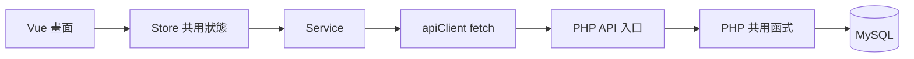

# LifeCharge V2 程式導讀

本文件依目前程式整理，適合從「讀 JSON」開始理解「透過 PHP 讀寫 MySQL」。所有付款都是模擬，沒有串接金流；卡號不是訂單資料，也不會送到購買 API。

## 1. 先理解這四層

| 層次 | 本專案範例 | 負責的事 |
| --- | --- | --- |
| 畫面 | `LoginDialog.vue`、`Checkout.vue` | 接收操作、顯示資料、提示進度或錯誤。 |
| Store | `authStore.js`、`gameStore.js`、`cartStore.js` | 保存多個畫面共用的狀態，例如目前會員與購物車。 |
| Service | `authService.js`、`gameService.js`、`purchaseService.js` | 取得資料、呼叫 API、確認回傳格式適合前端使用。 |
| 後端 | `backend/public/api/*.php` 與 `backend/src/*.php` | 驗證請求與身份、查詢資料、決定是否接受寫入。 |

MySQL 不直接連到 Vue。Vue 請 PHP 查詢，PHP 將結果編成 JSON 回傳；所以前端收到的仍是熟悉的 JavaScript 資料。



結帳有一個例外：`Checkout.vue` 直接呼叫 `purchaseService.js`；目前沒有額外建立 purchaseStore。成功後再將擁有權同步給 authStore、移除 cartStore 中本次購買的商品。

## 2. 開站時發生什麼事

讀取順序：`main.js → systemStore → gameStore → authStore → cartStore → Router → App.vue`。

1. main.js 建立 Vue、Pinia、Vuetify。`h(StartupScreen, ...)` 是 Vue 內建的元件渲染方式，畫面內容仍寫在 StartupScreen.vue。
2. systemStore.initialize() 在 dev 檢查 `/api/health`。後端與資料表就緒選 Database；不可用時選 Demo。正式 build 固定 Demo，不探測訪客的 localhost。
3. gameStore.initialize(mode) 載入該模式的遊戲資料與圖片網址。
4. authStore.initialize(mode) 在 Database 查 `/api/me`，在 Demo 恢復分頁會員暫存。
5. cartStore.initialize(mode) 恢復該模式購物車，排除不存在或已擁有的商品。
6. 身份準備好後才安裝 Router，避免會員頁在資料尚未載入時被誤認為未登入。
7. 路由與資料準備完成後顯示 App.vue；失敗則顯示錯誤與重新載入按鈕，不中途換模式掩蓋錯誤。

`lifecharge-startup-mode` 只記住此分頁上次成功使用的模式，不取代健康檢查。第一次進入或模式改變時顯示提示，最短 2 秒；同模式重新整理略過提示及固定等待，但仍要載入資料，期間可能短暫空白。模式改變的提示在判斷完成後開始計時。

`systemStore` 的 ready 只代表模式已決定；整站真正可以顯示，還要等 main.js 後續初始化完成。

## 3. PHP 檔案為什麼分成入口與工具

`backend/public/api` 是 HTTP 入口，例如 login.php 接收登入請求。`backend/src` 是重複使用的工具，例如登入與購買都需要會員身份驗證，因此共同使用 user.php。

工具檔不是每支都要在瀏覽器開啟；Apache 只公開 backend/public。`require_once` 的意思是載入需要的 PHP 工具，同一請求不重複載入。

### 設定與匯入

| 檔案 | 用途 | 何時使用 |
| --- | --- | --- |
| `backend/config/database.example.php` | 資料庫連線設定範本，不放真實密碼。 | 新環境複製成 local 設定。 |
| `backend/config/database.local.php` | 本機真實連線設定，由 Git 忽略。 | connectDatabase() 連線時讀取；不提交、不公開。 |
| `backend/config/app.php` | Session 期限、允許來源、限流與報價期限。 | PHP 各工具透過 appConfig() 讀取。 |
| `backend/scripts/seed.php` | 將初始 JSON 與擁有權匯入資料庫。 | CLI 手動執行；預設唯讀，加 --apply 才寫入，不是每次開站都執行。 |
| `database/schema.sql` | 建立五張資料表與限制。 | 建置資料庫時使用，不用來讀取網頁資料。 |

### HTTP 入口

| PHP 檔案 | 前端 API／方法 | 接收與回傳 | 資料庫影響 |
| --- | --- | --- | --- |
| `health.php` | GET `/api/health` | 回傳服務名稱、連線與 ready 狀態。 | 唯讀檢查。 |
| `games.php` | GET `/api/games` | 回傳遊戲清單，JSON 欄位轉成陣列。 | 唯讀 games。 |
| `csrf.php` | GET `/api/csrf` | 回傳此 Session 的操作驗證 token。 | 不存取 MySQL，可能建立 Session token。 |
| `me.php` | GET `/api/me` | 回傳目前會員公開欄位與 purchasedGames；未登入為 401。 | 唯讀 users、user_games。 |
| `login.php` | POST `/api/login` | 接收 identifier、password，驗證後回傳會員並建立登入 Session。 | 唯讀會員資料；登入身份寫入 PHP Session。 |
| `register.php` | POST `/api/register` | 接收註冊欄位；成功新增並自動登入。 | 新增 users，以交易處理。 |
| `logout.php` | POST `/api/logout` | 清除登入 Session 與對應 Cookie。 | 不刪除資料庫會員或訂單。 |
| `quote.php` | POST `/api/checkout/quote` | 接收 gameIds；回傳 quoteId、商品、總價與 expiresAt。 | 唯讀商品與擁有權；報價存在 PHP Session。 |
| `purchases.php` | POST `/api/purchases` | 接收 quoteId、requestKey；回傳訂單與最新擁有權。 | 成功時同一交易寫入 orders、order_items、user_games。 |
| 同上 | GET `/api/purchases?requestKey=...` | 查目前會員此識別碼的成功訂單；沒有為 404。 | 唯讀；不會因查詢建立訂單。 |

`/api/checkout/quote` 是前端 URL，不是實體資料夾。vite.config.js 將它改寫到 Apache 的 `/lifecharge-backend/api/quote.php`；其他 API 也由 proxy 對應 PHP。preview 沒有這個 dev proxy。

### 共用函式：身份與請求

表格中的「呼叫處」列主要使用者，不表示只能在那裡使用。

| 檔案／函式 | 輸入 → 結果 | 主要呼叫處與影響 |
| --- | --- | --- |
| database.php：connectDatabase() | local 設定 → PDO 連線 | 需要 MySQL 的 API。建立連線，本身不新增資料。 |
| response.php：sendJson() | payload、HTTP 狀態 → JSON 回應並結束請求 | sendSuccess、sendError 的共用出口。 |
| sendSuccess()／sendError() | data 或錯誤碼／訊息 → 統一格式 | API 回應；不是資料庫操作。 |
| request.php：requireRequestMethod() | 允許的方法 → 通過或 405 | 各 API 入口，避免用錯 GET／POST。 |
| requireAllowedOrigin() | HTTP Origin → 通過或 403 | 寫入 API，檢查請求來自設定允許的前端來源。 |
| readJsonBody() | HTTP JSON body → PHP 陣列 | POST API，檢查類型、大小與 JSON 物件格式。 |
| session.php：appConfig() | 無 → app 設定陣列 | Session、Origin、限流、報價工具。 |
| startAppSession() | Cookie／Session → 開啟 Session、檢查閒置期限 | 身份與 CSRF 工具；到期時清除登入狀態。 |
| touchAppSession() | 已登入 Session → 更新 last_activity | 成功建立報價／完成購買，不是每次背景查詢都延長登入。 |
| prepareMemberSession() | userId → 新 Session 資料陣列 | 登入／註冊；更新 Session ID、產生 token，呼叫者再賦值給 $_SESSION。 |
| csrf.php：rotateCsrfToken() | 無 → 新 token | token 需要建立或更新時，存於 Session。 |
| getCsrfToken() | Session → 現有或新 token | csrf API。 |
| requireCsrfToken() | X-CSRF-Token 與 Session → 通過或 403 | 寫入 API；確認 token 屬於此瀏覽器 Session。 |
| user.php：findLoginUser() | PDO、帳號／Email → id 與 passwordHash 或 null | login.php 內部比對密碼，雜湊不回傳前端。 |
| findPublicUserById() | PDO、userId → 公開會員資料或 null | me、登入、購買等；查 users 與 user_games，不包含密碼雜湊。 |
| requireMemberId() | Session → userId 或 401 | 先確認登入，避免未登入仍嘗試查 DB。 |
| requireAuthenticatedMember() | PDO → 仍存在的目前會員或 401 | 需要身份的 API，再確認資料庫中確有此會員。 |
| validateRegistration() | 註冊資料 → 正規化資料或欄位錯誤 | register.php；不查重、不寫 DB，唯一限制由資料庫保證。 |
| rateLimit.php：requireRateLimit() | login／register → 通過或 429 | 計算指定來源 IP 在時間窗內的請求數，資料在 backend/storage，不在 MySQL。 |

`requireMemberId` 與 `requireAuthenticatedMember` 是兩層檢查：前者查 Session，後者再查資料庫會員是否存在。CSRF 則檢查操作驗證，不是另一個登入系統，也不能取代會員身份與資料權限檢查。之前的 auth.php、validation.php 已合併到現有工具，不需要重建。

### checkout.php：從報價到訂單

| 函式 | 輸入 → 結果 | 用途與資料庫影響 |
| --- | --- | --- |
| validateCheckoutGameIds() | 商品編號清單 → 去歧義後排序的合法清單 | 不接受重複、非正整數或過長清單；不寫 DB。 |
| moneyToCents()／centsToMoney() | 金額字串 ↔ 整數分 | 精確比較與加總，避免浮點誤差；不寫 DB。 |
| loadCheckoutQuoteData() | PDO、會員、商品編號 → 商品與總價 | 讀 games、user_games，拒絕不存在或已擁有的商品。 |
| createCheckoutQuote() | PDO、會員、商品編號 → 報價 | 呼叫上項，把報價放 Session、設定期限並更新活動時間。 |
| validatePurchaseRequestKey() | 識別碼 → 合法字串 | 限制格式，不證明會員身份。 |
| findPurchaseByRequestKey() | PDO、會員、識別碼 → 訂單或 null | 查 orders／order_items 的成交快照，不用現價改寫歷史訂單。 |
| requireCheckoutQuote() | quoteId、會員 → 有效 Session 報價 | 檢查擁有者、存在與期限；失敗拋 CheckoutException。 |
| lockCheckoutMember() | 交易中的 PDO、會員 → 鎖定會員資料列 | 讓使用同樣鎖定規則的購買依序處理，直到交易結束。 |
| verifyLockedCheckoutQuote() | PDO、會員、報價 → 最終成交資料 | 交易內鎖定商品、再查擁有權、比價、檢查到期時間，不直接寫訂單。 |
| completeCheckoutPurchase() | PDO、會員、quoteId、requestKey → 訂單 | 統籌交易，查重、驗證、寫三張表；成功 commit，例外 rollback。 |

CheckoutException 用來帶出可預期的業務錯誤，例如 PRICE_CHANGED；一般例外則由 API 回傳通用的 503，不把 SQL 或內部錯誤直接顯示給使用者。

## 4. 前端函式的分工

### Service

| 檔案／函式 | 呼叫者 → 結果與作用 |
| --- | --- |
| apiClient.js：requestApiJson() | GET／POST 包裝函式 → fetch、逾時控制、JSON 解碼與 ApiError。它不判斷要切哪個模式，也不自動重送。 |
| getApiJson()／postApiJson() | 各 Service → API 的 data。GET 預設最多 3 秒，POST 預設 10 秒。 |
| getCsrfToken() | 會員與購買 Service → 通過格式檢查的 token，用於接下來的 POST。 |
| healthService.js：checkBackendHealth() | systemStore → 經格式檢查的健康狀態。 |
| gameService.js：loadGames(mode) | gameStore → 該模式遊戲清單，分派到 loadDemoGames 或 loadDatabaseGames。 |
| loadDemoGames()／resolveDemoImage() | JSON 與本機圖片 → 前端可用的遊戲資料。 |
| loadDatabaseGames()／resolveDatabaseImage() | API 與後端媒體路徑 → 驗證清單並轉完整圖片 URL。 |
| authService.js：normalizeMember() | Database 會員回應 → 欄位、擁有權與頭像 URL 檢查。normalizeDemoMember() 則處理 Demo 格式。 |
| getDatabaseMember() | authStore → 會員或 null；只有明確未登入才回 null，503 不假裝登出。 |
| loginDatabaseMember()／registerDatabaseMember() | authStore → 帶 CSRF 的 POST 與標準化會員。 |
| logoutDatabaseMember() | authStore → 確認後端完成登出，失敗則拋錯。 |
| recoverDatabaseSession() | authStore → 重新查會員並取得 token，不自動重送原操作。 |
| purchaseService.js：normalizeSummary()／normalizePurchase() | API 回應 → 檢查金額合計、商品、會員、識別碼與訂單格式。 |
| createDatabaseQuote(gameIds) | Checkout → 報價；不送卡號。 |
| createPurchaseRequestKey() | Checkout → 一次購買使用的隨機識別碼。 |
| submitDatabasePurchase(quoteId, requestKey) | Checkout → 訂單與最新擁有權；不在 Service 自動重試。 |
| findDatabasePurchase(requestKey) | Checkout → 成功訂單或明確 404 的 null；連線失敗不當成沒有訂單。 |
| loadPendingDatabasePurchase()／savePendingDatabasePurchase() | Checkout → 依會員讀寫尚待確認的購買，檢查格式並避免覆蓋別筆紀錄。 |
| clearPendingDatabasePurchase() | Checkout → 只清除符合會員與識別碼的紀錄，不會刪除 MySQL 訂單。 |

normalize、invalid 等私有小函式集中處理格式驗證；同一個結果若會被登入、重新整理、購買恢復等多處使用，就不必每處重寫檢查。前端檢查是避免畫面誤用資料，後端仍須獨立驗證，不能信任瀏覽器輸入。

### Store

| 檔案／函式 | 主要呼叫者與用途 |
| --- | --- |
| systemStore.initialize() | main.js：決定模式，共用一次啟動 Promise；不初始化其他 Store。 |
| gameStore.initialize(mode) | main.js／測試頁：載入遊戲並保存 source、loadStatus；失敗不偷偷讀 Demo。 |
| getGameById() | 商品卡、購物車、結帳等：依編號取得遊戲。 |
| searchGames()／getGamesByGenre() | 搜尋畫面：依關鍵字、類型篩選。 |
| getNewGames()／getBestsellers()／getFeaturedGames() | 首頁：依標籤取出推薦清單。 |
| authStore.initialize(mode) | main.js：Database 查 me，Demo 恢復暫存。 |
| login()／register()／logout() | 登入視窗／會員頁：按模式分派操作，同步 currentUser；Database 註冊才使用後端。 |
| runMemberAction() | 上述會員操作共用：忙碌保護、CSRF 身份恢復，最後解鎖；不重送原操作。 |
| loginDemo()／logoutDemo()／restoreSession() | Demo 身份比對、清除、從 sessionStorage 還原。不是後端 Session。 |
| requestLogin(destination)／cancelLogin() | 導覽、路由、結帳：控制登入視窗與成功後目的地。 |
| purchaseGames()／savePurchases()／restorePurchases() | Demo 結帳與還原：只修改 Demo 暫存，不寫 MySQL。 |
| applyDatabasePurchaseResult(result, expectedUserId) | Checkout：核對目前會員後同步已確認的後端擁有權，不自己創造訂單。 |
| revalidateDatabaseMember() | Checkout 等：重新確認後端會員身份及 token。 |
| cartStore.initialize(mode)／restoreCart() | main.js：選擇對應模式的暫存並清理非法、重複與已擁有商品。 |
| isInCart()／addToCart() | 購買按鈕：查詢、加入，拒絕不存在或已擁有的遊戲。 |
| removeFromCart()／removePurchasedGames() | 購物車、登入後清理、成交後同步。深度 watch 負責保存購物車。 |
| notificationStore.showMessage(text) | 畫面操作：顯示共用 Snackbar，不存會員或訂單。 |

## 5. 跟著一次登入追程式

```text
使用者輸入帳號／Email、密碼
→ LoginDialog.vue 呼叫 authStore.login()
→ Database 分支呼叫 loginDatabaseMember()
→ 先 GET csrf，再 POST login
→ login.php 檢查方法、Origin、限流、CSRF、欄位
→ findLoginUser() 查 users，password_verify() 比對雜湊
→ findPublicUserById() 取得公開會員與擁有權
→ prepareMemberSession() 更新登入 Session
→ API 回傳會員，Service 驗證格式
→ Store 更新 currentUser，畫面顯示登入成功
```

Cookie 幫瀏覽器與後端對應 Session；前端不靠 sessionStorage 的會員編號證明 Database 身份。重新整理時透過 me 查詢，因此不必再輸入密碼。me 的 401 代表未登入；503 代表無法確認，不可混為一談。

## 6. 跟著一次購買追程式

假設會員購買遊戲 4（示例，實際請選尚未擁有的商品）：

1. Checkout.submitPayment() 檢查模擬付款欄位，再呼叫 createDatabaseQuote([4])。
2. quote.php 確認會員，createCheckoutQuote() 讀後端價格與擁有權。回傳 quoteId、到期時間、商品與總價；報價預設 5 分鐘。
3. 畫面顯示報價，使用者再按「確認購買」。有報價不代表已成交。
4. confirmDatabasePurchase() 建立 requestKey，先把待確認紀錄寫入此會員的 sessionStorage，再 POST 購買。這樣回覆遺失仍有資料可追查。
5. purchases.php 使用 Session 身份，呼叫 completeCheckoutPurchase()。瀏覽器不能自己指定要替哪位會員買。
6. 後端開始交易、鎖會員、查是否已有相同 requestKey 的訂單；若已存在就回傳原訂單。若仍有 Session 報價可比對，也檢查是否挪作其他內容。
7. 新購買再檢查報價、商品現價、期限與擁有權。訂單明細保存成交時的名稱與單價，不隨未來商品改價而變。
8. 寫 orders、order_items、user_games；全部成功才 commit，途中例外 rollback。
9. API 回傳訂單與擁有權。applyConfirmedDatabasePurchase() 核對結果，更新 authStore，移除本次已購商品，進入完成畫面並清除待確認紀錄。

| 資料 | 例子 | 用途 |
| --- | --- | --- |
| gameId | 4 | 哪款遊戲。 |
| quoteId | 後端產生的字串 | 哪次報價，存在 Session，有期限。 |
| requestKey | 前端產生的隨機字串 | 哪次購買意圖，重試與查詢時沿用，消費者不用操作。 |
| orderId | 訂單編號 | 已完成的訂單，來自資料庫。 |

自動編號跳號不代表多了一筆訂單。失敗／回滾可能消耗 AUTO_INCREMENT，應查實際訂單列，不用編號連續性判斷成功與否。

## 7. 斷線時怎麼走

| 狀況 | 行為 |
| --- | --- |
| dev 啟動時後端不可用 | 模式判斷可選 Demo。已記錄的模式若改變，顯示提示。 |
| Database 中取得報價失敗 | 顯示錯誤，留在原步驟；恢復後使用者再次操作，不切 Demo。 |
| POST 已送出但回覆遺失／503 | 結果不明，開始 GET 查原 requestKey，不能直接當作未成交。 |
| 查到成功訂單 | 更新擁有權並顯示完成，不再 POST。 |
| 明確 404 PURCHASE_NOT_FOUND | 停止自動查詢，紅色提示再次確認；使用者按一般確認購買，內部保留原 key。 |
| 查詢仍斷線／逾時 | 顯示連線提示，每 3 秒再查；online 事件可喚醒，不自動 POST。 |
| 登入過期 | 保留待確認紀錄，請原會員登入；重新確認身份後恢復處理。 |
| 會員換人／元件已離開 | 忽略舊查詢的遲到結果，不把舊會員擁有權套到新會員。 |
| 報價過期／價格改變 | 清除此已明確失敗的待確認操作，重新取得報價並讓使用者確認。 |

Checkout 的 stopPurchaseQuery、schedulePurchaseQuery、startPurchaseQuery、resumePurchaseQuery 管理計時與喚醒；queryPendingPurchase 實際查詢；canResolvePurchase 用版本與會員身份判斷結果是否仍可套用。onBeforeUnmount 清除計時器與事件，onBeforeRouteLeave 清除付款欄位。這些函式處理的是「等待中的購買」，不是每次讀取遊戲都需要的流程。

訊息統一在步驟下方、卡片上方，沒有訊息不留高度。消費者不看識別碼，也沒有手動查詢按鈕。網路恢復不代表瀏覽器自動接回失敗的 HTTP 請求；是上述查詢程式重新發出 GET。

## 8. 資料到底放在哪裡

| 資料 | Demo | Database |
| --- | --- | --- |
| 遊戲 | JSON 與前端圖片 | games 與後端 media。 |
| 登入身份 | lifecharge-current-user-id 分頁暫存 | PHP Session 與 Cookie。 |
| 購物車 | lifecharge-cart | lifecharge-database-cart，仍是分頁暫存，不存 MySQL。 |
| 擁有權 | lifecharge-user-purchases | user_games。 |
| 訂單 | 不建立 MySQL 訂單 | orders、order_items。 |
| 待確認購買 | 不使用 Database 紀錄 | lifecharge-database-pending-purchase-會員編號。 |
| 上次啟動模式 | lifecharge-startup-mode | 同一個 key，只供提示判斷。 |

同一分頁中兩套暫存同時存在是正常的。SessionStorage 不提供跨裝置持久化；關閉分頁通常會結束該分頁的暫存，但瀏覽器復原分頁、複製分頁等行為可能保留或複製內容，不應把關閉視窗當安全登出機制。Database 仍以後端身份驗證為準。

## 9. 想改行為時看哪裡

| 想修改 | 優先閱讀 |
| --- | --- |
| 提示文字、外觀 | StartupScreen.vue；模式文字在 main.js。 |
| 提示最短時間／健康檢查逾時 | src/config/system.js，兩個值用途不同。 |
| 何時顯示提示／資料載入順序 | main.js。 |
| 模式選擇規則 | systemStore.js、healthService.js、health.php。 |
| 後端圖片位置 | system.js 的 DATABASE_MEDIA_BASE_URL 與 Apache media。 |
| 登入 UI／註冊欄位 | LoginDialog.vue；後端規則在 user.php，必須一起核對。 |
| 閒置期限／允許來源／限流／報價期限 | backend/config/app.php；HTTP 本機與 HTTPS 部署不能混用設定。 |
| 遊戲查詢或回傳欄位 | games.php、gameService.js、gameStore.js。 |
| 成交價格與寫入規則 | backend/src/checkout.php，不只改畫面總價。 |
| 購買訊息、背景查詢、成功步驟 | Checkout.vue。 |
| 購買 API 格式／待確認暫存 | purchases.php、purchaseService.js。 |
| API 網址到 PHP 的對應 | vite.config.js；只對 dev 生效。 |

## 10. 已驗證與限制

- 已驗證正常報價／購買、重新登入保留擁有權、價格與期限錯誤、相同請求只建一筆訂單，以及暫時拋例外後三張表回滾；測試例外已移除。
- 自動恢復測試共 8 項，使用模擬回應，不是實際 MySQL 並行測試：`node test/phase6/checkout-recovery.test.mjs`。
- 使用者已回報正式 Database 購買、報價斷線恢復、模式資料隔離、會員路由保護、preview 固定 Demo 與手機畫面正常。Phase 7 最後一輪 8 項 PASS，build 成功（523ms）。
- 同 Session 兩請求可能被 PHP 依序處理，跨 Session／跨連線真正並行寫入尚未驗證。
- 尚未更新公開 main 部署；feature/v2 推送不更新 GitHub Pages，本機 preview 不等於公開站驗收。
- 本機後端使用 Require local、HTTP Cookie 設定；目前不是可直接公開部署的後端。沒有真實金流、管理後台、驗證信、忘記密碼與頭像上傳。
- 沒有完整離線網站功能。Demo 固定模式不代表斷網重新整理仍能下載網站。

推薦閱讀順序：先看第 1、2、5、6 節，能追完一次登入與購買後，再用函式表查細節；不需要一次背下所有名稱。
